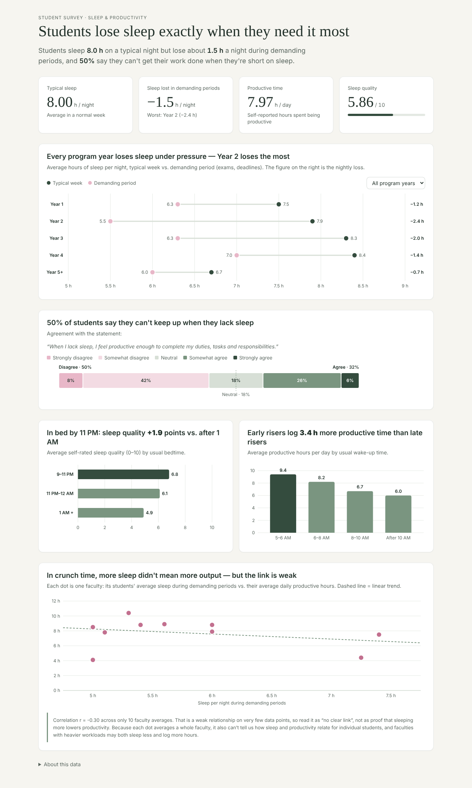

# Sleep Habits & Productivity in Students

An interactive dashboard exploring how students' sleep habits relate to their productivity, based on a survey of 50 students across 10 faculties.

**Live dashboard:** https://elsa-bakoup.github.io/student-sleep-dashboard/

## Key findings

- **Students lose sleep when it matters most.** They average 8.0 hours a night in a typical week but lose about 1.5 hours a night during demanding periods (exams, deadlines). Year 2 students lose the most (−2.4 h).
- **Half say lack of sleep hurts their work.** 50% of students disagree that they feel productive enough when short on sleep; only 32% agree.
- **Earlier bedtimes go with better sleep.** Students in bed by 11 PM rate their sleep quality about 1.9 points higher (out of 10) than those going to bed after 1 AM.
- **Early risers report more productive time.** Students waking at 5–6 AM log 3.4 more productive hours per day than those waking after 10 AM.
- **No clear link at the faculty level.** Across the 10 faculty averages, more sleep during demanding periods was not associated with more productive hours (r = −0.30, a weak relationship on few data points).

## Features

- Headline KPIs: typical sleep, sleep lost under pressure, productive hours, sleep quality
- Dot plot comparing typical vs. demanding-period sleep by program year, with a year filter
- Diverging bar chart for the survey's agree/disagree question
- Bar charts for sleep quality by bedtime and productivity by wake-up time
- Scatter plot with trend line and correlation, plus a note on how to interpret it
- Hover tooltips, responsive layout for desktop and mobile

## My role

The survey was designed and conducted as a group project. **I designed and built this dashboard**: choosing the chart types, structuring the story, writing the insight-driven titles and coding the page.

## Built with

- HTML, CSS and JavaScript
- [D3.js](https://d3js.org/) for the charts (bundled in the file, so the page works offline)
- Hosted on GitHub Pages

## Data notes

- Sample: 50 students from 10 faculties (n = 50). The scatter plot shows faculty averages, so it can't describe individual students.
- “Sleep lost” is typical minus demanding-period sleep; the overall average is the simple mean across program years.
- Correlation is not causation: these results show associations, not effects of sleep on productivity.

## Run it locally

Download `index.html` and open it in any browser. No installation needed.
